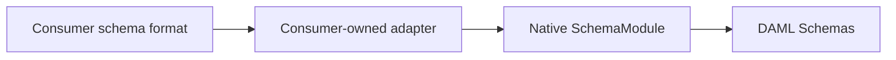

# Schema modules, defaults, and partial values

DAML uses JSON Schema 2020-12 constraints rather than a second general-purpose
schema language. A module can be written as JSON or as a JSON-compatible DAML
mapping. DAML adds explicit tag/extension contracts and deterministic default
completion; it does not execute application constructors.

JSON Schema's standard `default` is an annotation, not a command to mutate an
instance. DAML deliberately defines a separate completion step, followed by full
validation. [Standard annotation semantics](https://json-schema.org/understanding-json-schema/reference/annotations#default)

## Write a module in DAML

```daml
{
  types: {
    app.Request: {
      schema: {
        $id: "urn:example:Request"
        type: "object"
        properties: {
          params: {
            type: "object"
            default: {
              timeout: 30
              retries: 2
            }
            properties: {
              timeout: { type: "integer" }
              retries: { type: "integer" }
              endpoint: { type: "string" }
            }
            required: [
              "timeout"
              "retries"
              "endpoint"
            ]
            additionalProperties: false
          }
        }
        required: ["params"]
      }
    }
  }
}
```

A supplied `!app.Request { params: { endpoint: "/v1" } }` completes to params
containing `timeout: 30`, `retries: 2`, and the supplied endpoint. Supplying
`timeout: 5` overrides 30. Omitting the endpoint is still an error: the default
object can be partial, but the completed request cannot lack required values.

The JSON representation has the same module keys and JSON Schema content;
only the serialization changes. Use `SchemaModule::from_daml`, `from_json`, or
`from_value`, then `Schemas::compose`. Unknown module-envelope fields are errors.
Native schema documents are JSON-compatible values: tags in a schema document
are rejected rather than silently discarded. Data documents remain fully tagged.
Duplicate JSON object members are rejected, including escaped spellings of the
same key. `from_value` receives an already constructed map, so duplicate-key
admission belongs to its caller.

## Compose independently owned definitions

The module envelope has three optional sections:

- `types`: literal tag name to `{ schema: <JSON Schema>, implements: [...] }`.
- `contracts`: literal extension-contract name to its structural JSON Schema.
- `resources`: explicit `{ uri: "...", schema: ... }` entries for references.

`implements` is optional. A type may implement several contracts, but its data
must satisfy each contract's constraints; it is not an unchecked membership
label. Duplicate/conflicting names or resource identifiers fail composition,
including bindings supplied by an external adapter. Module order is not precedence.

Use `$id`, `$ref`, and `$defs` for schema references. They identify explicitly
registered in-memory resources; an HTTP-looking identifier is not permission to
fetch anything. [JSON Schema identifiers and references](https://json-schema.org/understanding-json-schema/structuring)

Two DAML validation keywords connect schemas to tag metadata:

- `x-daml-tag`: a literal tag string or nonempty array of allowed literal tags.
- `x-daml-slot`: a declared contract name, requiring an explicit tag whose binding
  implements that contract, plus the contract's structural constraints.

For example, a host field can declare `{ x-daml-slot: "app.Adapter" }`. A separate
provider exports a type implementing `app.Adapter`; adding that module requires
no edit to a central `oneOf` discriminator union. Both the host's field constraint
and the node's own tag assertion apply. An open field does not suppress assertions
on tagged descendants.

These checks operate on an immutable tag-aware JSON representation, including
inside `anyOf`/`oneOf`. There is no fake tag property injected into application
objects and no thread-local "current document" registry.

## Resolve, then inspect the completed result

```rust
let module = daml::SchemaModule::from_daml(schema_source)?;
let schemas = daml::Schemas::compose([module])?;
let supplied = daml::parse(input_source)?;
let resolved = schemas.resolve(&supplied)?;
let params = resolved.root().get("params").unwrap();
```

`resolve_as` additionally applies a named root type even when the root is
untagged. It does not waive a different explicit tag assertion. The original
parsed document is not mutated. The resolved result borrows input/schema data
where possible, exposes read-only values/tags/origins, and can export completed
plain data with `to_json`. That export deliberately excludes tag metadata;
`ResolvedNode::tag` retains it for application adapters.

Run the complete multi-module consumer:

```sh
cargo run --locked --example resolve -- examples/application.daml \
  examples/schemas/application.daml examples/schemas/network.json \
  examples/schemas/text.daml
```

It validates nested records, scalars, and arrays; fills the adapter timeout and
request ID; and prints completed JSON data. It does not invoke an adapter.

## Exact completion rules

- Supplied values win. Explicit `null` is supplied data, never an omitted value.
- Object defaults merge recursively with supplied partial objects. Unknown
  supplied fields are retained so `additionalProperties` can reject them.
- Supplied arrays and scalars replace a default value; arrays are not concatenated.
- A missing property is created only by an explicit applicable default, not by
  guessing that a new object should exist because its children have defaults.
- A parent object preset is already present when child fallback defaults are
  considered. A preset value is not overwritten by a child's fallback.
- A default may itself be partial. Required fields and all other constraints are
  checked on the completed result, not on that default literal in isolation.
- Conflicting applicable defaults for a still-missing path are an error, not a
  last-module-wins rule. Explicit supplied data at that path takes precedence.
- Union branches complete isolated candidates. Different valid completed values
  are ambiguous and rejected, rather than choosing the first branch. `oneOf`
  still requires exactly one valid branch; `anyOf` may accept several branches
  only when completion yields the same value.

Default completion supports structural `properties`, `additionalProperties`
(without pattern selection), `items`/`prefixItems`, `$ref`, `allOf`, and
unambiguous union paths. Branch candidates are checked against the completed
document's ancestor constraints before ambiguity is reported. Unions without
reachable defaults use ordinary validation without enumerating unchanged data.
Defaults reachable in unsupported applicator positions—negation, conditionals,
`contains`, `propertyNames`, `dependentSchemas`, pattern-selected properties, or
unevaluated/content schemas—fail composition instead of being silently ignored.
Those constraints without defaults remain ordinary engine validation.

When `$schema` is present, it must select Draft 2020-12. The legacy
`dependencies` and `additionalItems` keywords, plus the pre-2020-12 array form
of `items`, are rejected rather than delegated to engine compatibility behavior.
Use `dependentSchemas`, `dependentRequired`, and `prefixItems`.

## Consumer-owned schema adapters

A consumer that uses another schema format converts it before calling DAML.
The dependency direction is:



The adapter owns vendor wire fields, discriminator rules, aliases, and foreign
reference syntax. DAML receives native JSON Schema plus its declared keywords.
The schema loader and resolver do not inspect consumer fields, callables, or
foreign reference schemes. They do not fetch resources. The consumer supplies
each canonical resource and each type binding explicitly.

Use `SchemaModule::from_value` when the adapter has built the native module
envelope. The consumer can translate a record marker into native keywords,
then register two type names against one canonical resource:

```json
{
  "types": {
    "vendor.Short": {"schema": {"$ref": "https://schemas.example.invalid/item"}},
    "vendor.Canonical": {"schema": {"$ref": "https://schemas.example.invalid/item"}}
  },
  "resources": [{
    "uri": "https://schemas.example.invalid/item",
    "schema": {
      "type": "object",
      "x-daml-tag": ["vendor.Short", "vendor.Canonical"],
      "properties": {"name": {"type": "string"}}
    }
  }]
}
```

These are ordinary JSON Schema references and independent DAML type bindings.
The adapter decides which consumer names map to the resource and emits the
native `x-daml-tag` assertion. DAML does not derive aliases from schema fields
or rewrite the reference URI.

### Annotate tags on defaults

The native `x-daml-default-tags` keyword assigns tags to values inside the
schema's `default`. Its value is an array of records with exactly two fields:
`path`, an RFC 6901 pointer relative to the default root, and `tag`, a nonempty
literal tag string. Use the empty path `""` for the default root. Each path must
identify a value in the default, and paths must be unique.
The schema must contain `default`.

```json
{
  "type": "object",
  "default": {"payload": {"value": 1}},
  "x-daml-default-tags": [
    {"path": "/payload", "tag": "vendor.Payload"}
  ]
}
```

The annotation preserves the default as ordinary JSON data. It does not add a
field to that data or reinterpret names such as `__type__` and `__fn__`.
Tags apply only when their default is inserted or object-merged. Overriding a
scalar or array default also discards its tag; that discarded assertion cannot
leak onto supplied data.
Malformed records, unknown fields, invalid or duplicate paths, missing targets,
and an empty annotation array are rejected during schema admission. The declared
tag must satisfy DAML's existing provisional tag-name rules.

`examples/schema_adapter.rs` contains a complete consumer-side conversion from a
made-up vendor format. It maps that format's record marker and default-tag
metadata to native keywords, registers a canonical resource, and binds both root
names and the nested settings type with regular `$ref`s. It then composes the
module and resolves a tagged input. No consumer-specific adapter or callback
framework belongs in DAML.

## Diagnostics and bounds

Syntax errors, schema loading/composition errors, and resolution errors remain
distinct types. A resolution error has a structured kind, RFC 6901 instance
pointer, schema location when available, and supplied-input or default provenance.
Dots/slashes inside names are not inferred paths; JSON Pointer escaping applies
only in explicit diagnostic/reference pointers.

Provided values point to original UTF-8 source bytes. Generated values identify
the actual schema default, not fabricated input positions. Completion budgets
cover materialized nodes, bytes, and work including alternative candidates;
materialized nesting is bounded at 128.
Default resolution limits are 100,000 cumulatively materialized nodes, 8 MiB of
value/key/tag bytes, and 1,000,000 conservative work units. Alternative candidates
share those budgets. Validation charges expanded schema work against instance
nodes and text in 64-byte blocks. Schemas that can evaluate `uniqueItems` also
reserve worst-case exact pair-comparison work before entering the validator;
oversized comparisons return `LimitExceeded` rather than exceeding the budget.

Composition bounds the selected schemas to 10,000 JSON nodes and 8 MiB, compiled
schema-view copies to 8 MiB, and aggregate expanded compilation work to 100,000.
Both physical schema depth and expanded reference depth are bounded at 128.
Unresolved references, normalized identifier/anchor collisions, and references
into non-schema data fail before validation. Relative references, nested `$id`,
and anchors use the prepared registry's URI resolution.

Exact validation currently accepts at most 512 decimal digits and absolute
exponent 512. Larger numeric spellings still parse but fail resolution/schema
loading rather than entering upstream extreme-exponent fallback behavior or
rounding through floating point. This is a bounded implementation profile, not
an unbounded mathematical-conformance claim.

Schema graphs are bounded and cycles/dynamic references are rejected in this
profile. Reference retrieval is explicitly offline, format assertions disabled,
and regular expressions use a size-bounded linear engine. No custom user Rust
callbacks, default factories, templates, or environment reads are registered.

The implementation reuses `jsonschema` 0.59.0 (MIT), `serde_json` 1.0.154, and
`serde` 1.0.228 (both MIT OR Apache-2.0), pinned in Cargo and its lockfile.
HTTP/file/async retrieval features are disabled; arbitrary-precision support is
enabled. This does not imply that
transitive dependencies contain no unsafe code or that every JSON Schema draft
feature/default placement is supported. The native syntax parser remains its
own implementation; no upstream parser source was vendored.
